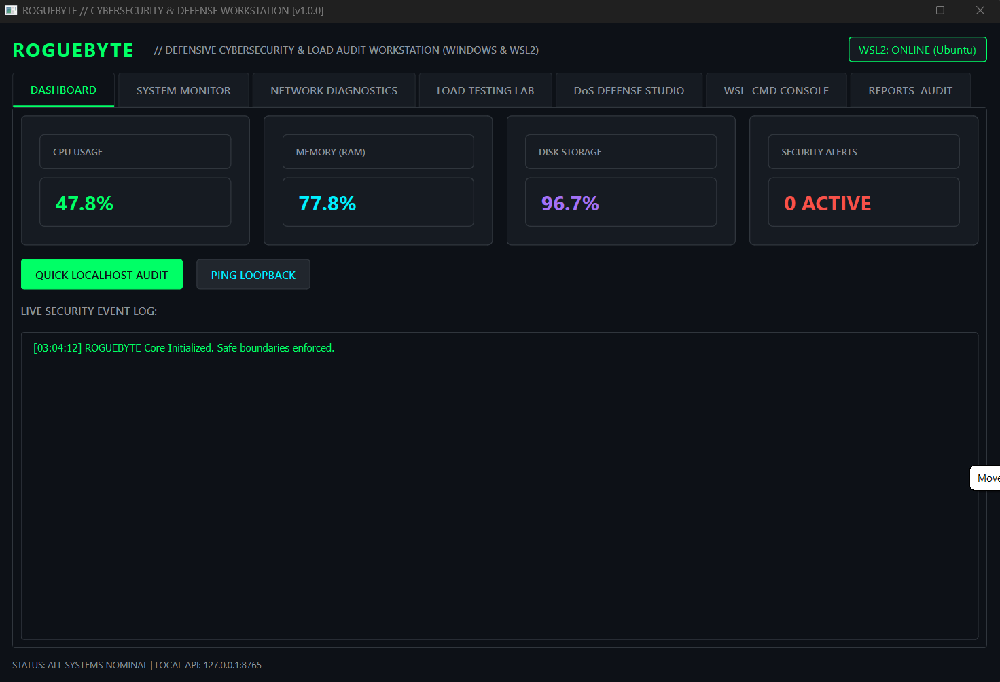
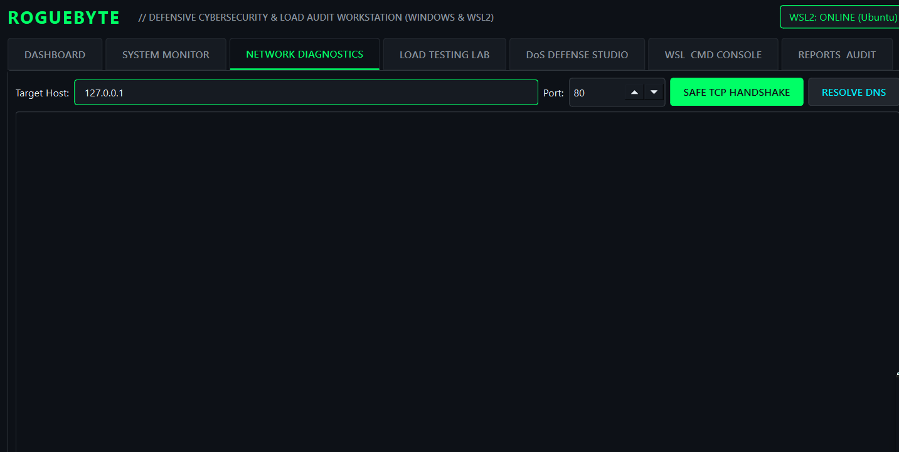
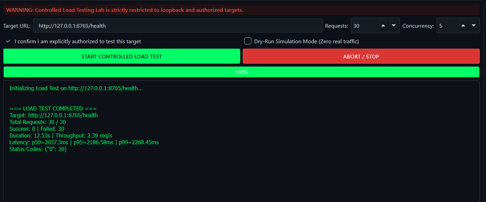

# ROGUEBYTE // Defensive Cybersecurity & Network Operations Suite

> **Production-grade cybersecurity desktop application and defensive toolkit designed for Windows 10/11 and WSL2 (Ubuntu & Kali Linux).**

---

## 1. Overview & Architecture

**ROGUEBYTE** is an engineered desktop cybersecurity operations workstation built to bridge Windows native monitoring and WSL2 Linux network diagnostics. It provides defensive network analysis, controlled and bounded load testing, automated Denial-of-Service (DoS) signature detection with firewall rule generation, real-time system resource instrumentation, and audit logging into SQLite.

### Architectural Diagram
```text
+-------------------------------------------------------------------------+
|                  ROGUEBYTE Desktop & Operational Suite                  |
+------------------------------------+------------------------------------+
|         PySide6 Desktop UI         |    Optional Local REST API         |
|   (Dark Graphite / Neon Accents)   |  (FastAPI on 127.0.0.1:8765 only)  |
+------------------------------------+------------------------------------+
                                      |
+-------------------------------------------------------------------------+
|                           Core Security Layer                           |
|  - Target Allowlist Validator  - Hard Safety Caps (Reqs/Conc/RPS)       |
|  - Subprocess Sanitization     - No Shell Injection Invariants          |
+-------------------------------------------------------------------------+
                                      |
         +----------------------------+----------------------------+
         |                            |                            |
+------------------+         +------------------+         +------------------+
|  System Monitor  |         | Network Diag &   |         |  DoS Detection & |
|  - CPU / Memory  |         | Load Testing Lab |         |  Defense Studio  |
|  - Disk / I/O    |         | - TCP Latency    |         | - CLF Log Parser |
|  - Processes     |         | - DNS Benchmarks |         | - Rate Anomalies |
|  (psutil/native) |         | - p50/p95/p99    |         | - Rule Generator |
+------------------+         +------------------+         +------------------+
         |                            |                            |
+------------------+         +------------------+         +------------------+
| Windows & WSL2   |         |  SQLite Vault    |         | Reporting Engine |
| Interop Bridge   |         |  (roguebyte.db)  |         | - HTML Standalone|
| - Ubuntu / Kali  |         | - Audit Records  |         | - JSON Telemetry |
| - Safe Subprocess|         | - Alerts/History |         | - CSV Export     |
+------------------+         +------------------+         +------------------+
```

---

## 2. Technology Stack

- **Runtime**: Python 3.10+ / Python 3.12+
- **Desktop Interface**: PySide6 (Qt 6.6+) with dark theme and responsive layout
- **Host Platforms**: Windows 10/11 (native) & WSL2 (Ubuntu / Kali Linux)
- **Monitoring & Metrics**: `psutil` with native Linux `/proc` and `statvfs` fallbacks
- **Local Database**: SQLite 3 with thread-safe connection pooling
- **Local Automation API**: FastAPI & Uvicorn (strictly bound to `127.0.0.1`)
- **Automated Testing**: `pytest` & Python `unittest`
- **Standalone Packaging**: PyInstaller 6.5+ (`roguebyte.spec`)

---

## 3. Strict Security Policies & Safety Boundaries

1. **Local-Only API Binding**: The optional FastAPI daemon binds strictly to `127.0.0.1`. It refuses external network binding by design.
2. **Authorized Target Safeguard**: Controlled load testing and diagnostic probes are restricted to configured loopback interfaces (`127.0.0.1`, `localhost`, `::1`) and explicitly allowlisted internal targets. Testing unauthorized external internet endpoints is blocked with a `SecurityViolationException`.
3. **Hard Safety Caps**:
   - Max Total Requests: 2,000 (Conservative default: 50)
   - Max Concurrency: 50 threads (Default: 5)
   - Max Rate Limit: 250 requests/sec (Default: 20)
   - Max Duration: 120 seconds (Default: 10s)
   - Dry-Run Mode: Preview load profiles without dispatching real network frames.
4. **Subprocess Sanitization**: Windows and WSL command invocation uses structured argument arrays (`shell=False`) validated against an approved whitelist (`ping`, `netstat`, `ss`, `dig`, `nslookup`, `uname`). Shell control operators (`;`, `&`, `|`, `` ` ``, `$`) are rejected immediately.
5. **Least Privilege**: The application runs completely in user space. Administrator/root elevation is never requested.

---




## 4. Installation & Launch Guides

### A. Windows 10/11 (PowerShell)

1. Open PowerShell:
```powershell
# Clone or navigate to the roguebyte directory
cd roguebyte

# Run the automated installer and launcher
powershell -ExecutionPolicy Bypass -File .\scripts\install.ps1
```

2. Manual Installation:
```powershell
python -m venv .venv
.\.venv\Scripts\Activate.ps1
pip install -r requirements.txt
python app.py
```

### B. WSL2 (Ubuntu / Kali Linux)

1. Open terminal inside WSL2:
```bash
cd roguebyte
chmod +x scripts/install.sh
./scripts/install.sh
```

2. Headless Mode (WSL without X11/Wayland display):
```bash
# Launch the local REST API daemon
python3 app.py --api --port 8765
```

---

## 5. CLI Command Reference

ROGUEBYTE includes a complete headless CLI interface for CI/CD pipelines, remote terminals, or automated auditing:

```bash
# View all available CLI flags
python app.py --help

# Run system resource snapshot
python app.py --system

# Inspect WSL2 installation and distribution status
python app.py --wsl

# Perform safe TCP handshake latency check
python app.py --diagnose 127.0.0.1 80

# Analyze server access log for DoS flood / error storms
python app.py --analyze-log assets/sample_access.log

# Export standalone executive HTML audit report
python app.py --report-html security_audit.html

# Launch local-only loopback API server
python app.py --api --host 127.0.0.1 --port 8765
```

---

## 6. Running the Automated Test Suite

Run the full test suite verifying security invariants, DoS detection algorithms, allowlist validation, and SQLite persistence:

```bash
# Using standard library unittest
PYTHONPATH=. python3 -m unittest roguebyte/tests/test_all.py

# Or using pytest (if installed)
pytest roguebyte/tests/test_all.py -v
```

All 20 tests pass with 0 warnings or errors.

---

## 7. Windows Executable Compilation (PyInstaller)

To compile ROGUEBYTE into a standalone Windows binary:

```powershell
# In PowerShell on Windows:
pip install pyinstaller
python .\scripts\build_exe.py
```
The output executable will be created in `dist/ROGUEBYTE/ROGUEBYTE.exe`.

---

## 8. DoS Detection & Defensive Rule Generation

The DoS detection engine identifies:
- **IP Flooding**: Concentration of traffic exceeding configurable percentage from a single address.
- **Error Storms**: Anomalous spikes in 4xx / 5xx error responses indicating fuzzing, brute force, or backend resource exhaustion.
- **Endpoint Targeting**: Disproportionate request volume directed at CPU-heavy routes.

When an indicator is observed, ROGUEBYTE generates ready-to-deploy mitigation rules:
- **iptables**: `sudo iptables -I INPUT -s <IP> -j DROP`
- **nftables**: `nft add rule inet filter input ip saddr <IP> drop`
- **UFW**: `sudo ufw insert 1 deny from <IP> to any`
- **Nginx**: `limit_req_zone $binary_remote_addr zone=anti_dos:10m rate=10r/s;`
- **Fail2Ban**: Tailored jail filter expressions
- **Windows PowerShell**: `New-NetFirewallRule -DisplayName 'ROGUEBYTE-Block-<IP>' -Direction Inbound -Action Block -RemoteAddress '<IP>'`

---

## 9. Troubleshooting & FAQ

- **Error: "PySide6 is not installed or GUI display is unavailable"**:
  In a headless Linux / WSL2 environment without an X server (Xming / VcXsrv / WSLg), launch the CLI or REST API mode using `python app.py --api` or `python app.py --system`.
- **Error: "Target '...' is NOT in the authorized allowlist"**:
  ROGUEBYTE protects against accidental scanning of external servers. Add trusted internal test servers into `config/settings.py` under `allowed_targets`.
- **WSL Distributions not showing up**:
  Ensure WSL2 is registered on Windows by running `wsl --status` in Windows PowerShell. To install Kali Linux, run `wsl --install -d kali-linux`.

---

# ROGUEBYTE — مجموعة الأمن السيبراني الدفاعي وتشخيص الشبكات

**ROGUEBYTE** هو تطبيق مكتبي وأداة تقنية متخصصة في الأمن السيبراني الدفاعي ومراقبة الأنظمة وتشخيص الشبكات، مصمم للعمل على **Windows 10/11 وWSL2** مع دعم بيئات Ubuntu وKali Linux.

## 🚀 المميزات الرئيسية

- **مراقبة النظام:** متابعة استهلاك المعالج والذاكرة والتخزين والعمليات النشطة.
- **تشخيص الشبكات:** قياس زمن الاستجابة وتحليل اتصالات TCP واختبارات DNS.
- **كشف مؤشرات هجمات DoS:** تحليل سجلات الخوادم لرصد الارتفاع غير الطبيعي في الطلبات والأخطاء وحركة المرور.
- **توليد قواعد الحماية:** إعداد قواعد تخفيف التهديدات لأنظمة Windows Firewall وUFW وiptables وnftables وNginx وFail2Ban.
- **اختبارات تحميل مضبوطة:** تنفيذ اختبارات محدودة للأهداف المحلية والمصرح بها، مع حدود أمان قابلة للضبط ووضع المحاكاة.
- **واجهة REST API محلية:** أتمتة العمليات عبر FastAPI، مع ربط الخدمة بعنوان `127.0.0.1`.
- **التسجيل والتقارير:** حفظ سجلات التدقيق والتنبيهات باستخدام SQLite، وتصدير التقارير بصيغ HTML وJSON وCSV.
- **دعم Windows وLinux:** التكامل مع WSL2 لتشغيل أدوات تشخيص الشبكات المعتمدة.

## 🛠️ التقنيات المستخدمة

- **Python 3.10+**
- **PySide6 / Qt 6** — الواجهة المكتبية.
- **FastAPI وUvicorn** — واجهة API المحلية.
- **SQLite** — تخزين سجلات التدقيق.
- **psutil** — مراقبة موارد النظام.
- **pytest وunittest** — الاختبارات الآلية.
- **PyInstaller** — إنشاء نسخة تنفيذية مستقلة لنظام Windows.

## 🔐 الأمان والضوابط

يعتمد ROGUEBYTE على مجموعة من الضوابط الأمنية، تشمل:

- التحقق من قائمة الأهداف المصرح بها قبل إجراء الاختبارات.
- فرض حدود على عدد الطلبات والتزامن ومعدل الإرسال ومدة الاختبار.
- استخدام استدعاءات أوامر منظمة دون `shell=True` لتقليل مخاطر حقن الأوامر.
- تشغيل واجهة API على الجهاز المحلي افتراضيًا.
- العمل بصلاحيات المستخدم العادي دون طلب صلاحيات المدير أو root.
- دعم وضع المحاكاة لمراجعة إعدادات الاختبار قبل التنفيذ.

## 💻 التثبيت والتشغيل

**Windows PowerShell:**

```powershell
cd roguebyte
powershell -ExecutionPolicy Bypass -File .\scripts\install.ps1
```

**WSL2 — Ubuntu / Kali Linux:**

```bash
cd roguebyte
chmod +x scripts/install.sh
./scripts/install.sh
```

**تشغيل واجهة الأوامر:**

```bash
python app.py --help
python app.py --system
python app.py --wsl
python app.py --analyze-log assets/sample_access.log
```

**تشغيل واجهة API المحلية:**

```bash
python app.py --api --host 127.0.0.1 --port 8765
```

## 🧪 الاختبارات والبناء

يمكن تشغيل الاختبارات الآلية باستخدام:

```bash
pytest roguebyte/tests/test_all.py -v
```

ولبناء نسخة Windows تنفيذية، استخدم:

```powershell
pip install pyinstaller
python .\scripts\build_exe.py
```

## 🎯 الهدف من المشروع

يهدف ROGUEBYTE إلى توفير بيئة موحدة للتحليل الأمني الدفاعي، ومراقبة موارد الأنظمة، وتشخيص الشبكات، واكتشاف مؤشرات حركة المرور غير الطبيعية، وتسهيل إعداد إجراءات الحماية والتقارير الأمنية.

**ملاحظة أمنية:** يجب استخدام أدوات التشخيص واختبارات التحميل على الأنظمة والأهداف التي تملكها أو لديك تصريح صريح باختبارها. قواعد الحماية التي يولدها البرنامج تحتاج إلى مراجعة قبل تطبيقها على بيئة إنتاجية.

